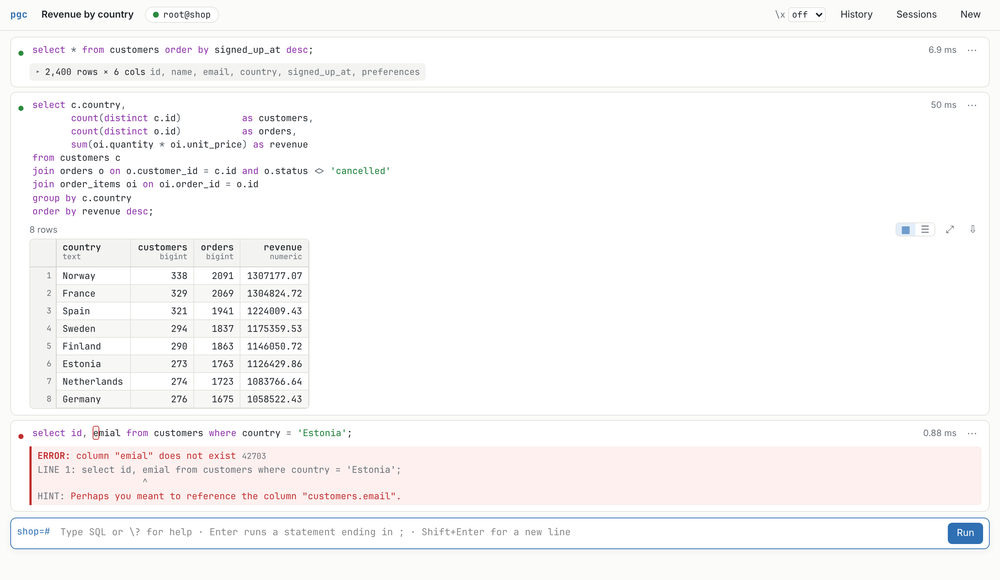
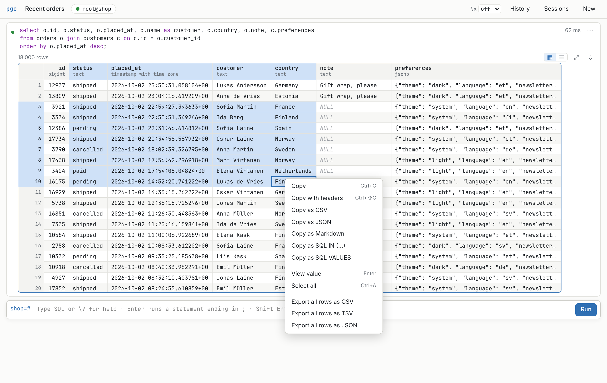
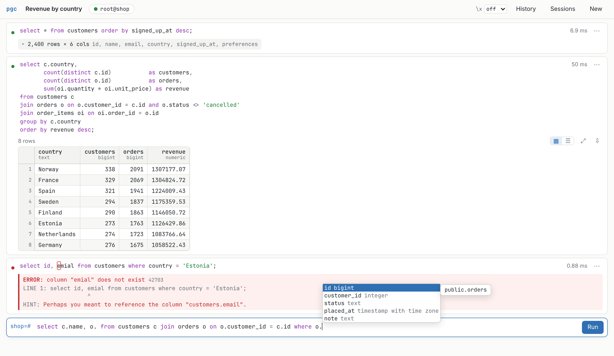
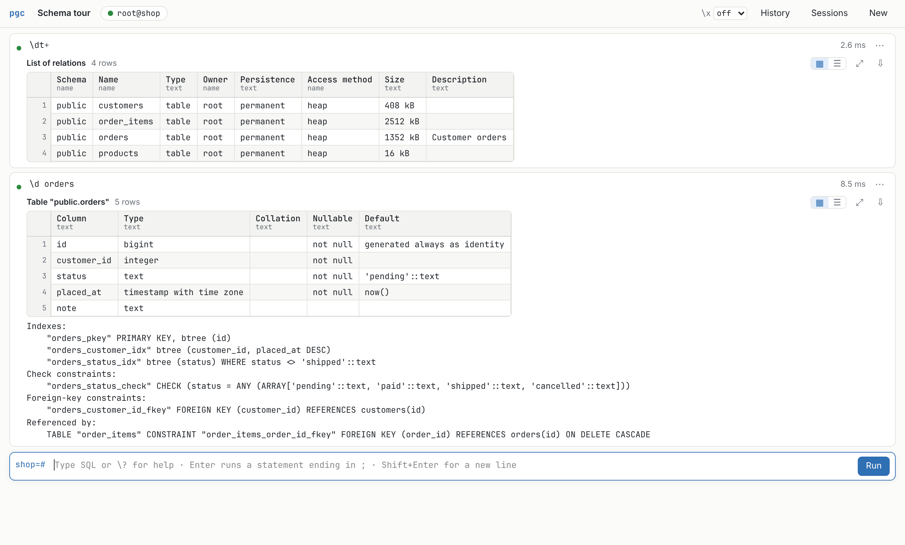
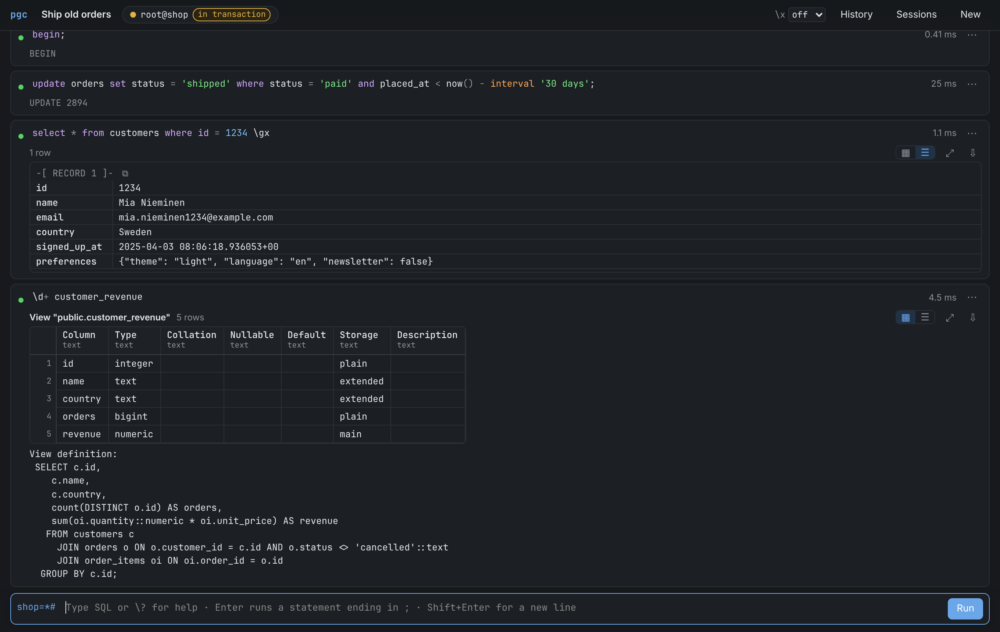
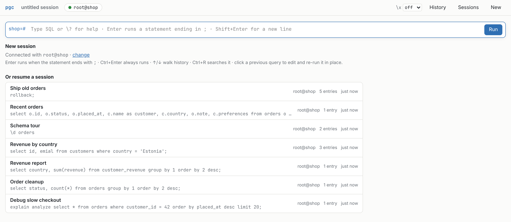

# pgc

A PostgreSQL client with a web UI, served locally by a single binary.

It keeps the interactive-psql workflow — write a query, see the result, keep
going — and fixes what a terminal can't do: results you can select and copy as
TSV, wide and long tables that stay readable, and a session history you can
come back to.



- **psql-compatible.** `\d`, `\dt+`, `\df`, `\l`, `\dn`, `\du`, `\dx`, `\sf`,
  `\sv`, `\x`, `\c`, `\conninfo`, `\copy`, `\i`, `\g`, `\gx`, `\gdesc` and more
  ([full list](#backslash-commands)), with psql's own catalog queries so the
  output looks the way you expect. Statements are split and sent like psql
  does, so `VACUUM`, `CREATE DATABASE` and friends just work.
- **One linear flow.** Each query becomes an entry in a transcript. Big results
  collapse into cards once you move on; click one to expand it.
- **Edit history in place.** Click a previous query to edit and re-run it where
  it is, so the transcript stays clean. Every execution is still recorded in the
  full history (`Ctrl+R`, `↑`/`↓`).
- **One browser tab = one session.** A new tab starts a fresh session; every
  session is saved and can be resumed from any tab (Sessions, `Ctrl+O`).
- **Results grid.** Virtualized, so a million rows scroll fine. Drag to select a
  rectangle, click headers / row numbers for whole columns / rows, `Ctrl+C` to
  copy as TSV (pastes straight into a spreadsheet), `Ctrl+Shift+C` with headers,
  right-click for CSV, JSON, Markdown, `IN (…)` lists and `VALUES` tuples.
  Export whole results as CSV/TSV/JSON. Double-click (or `Enter`) shows a full
  value, pretty-printed for json/jsonb. Expanded mode (`\x on|auto`) per session
  or per result.
- **Completions and highlighting** that know your schema: tables after
  `FROM`/`JOIN`, columns of the tables and aliases in the statement, schema
  qualified names, types after `::`, backslash commands and their arguments.
- **libpq configuration.** Connection strings and `postgresql://` URIs, `PG*`
  environment variables, `pg_service.conf`, `.pgpass`, TLS with all `sslmode`s
  (`sslrootcert`, client certificates, `sslrootcert=system`), Unix sockets,
  SCRAM-SHA-256 and MD5 authentication, multiple hosts.
- **PostgreSQL only**, on purpose.

## Screenshots

**Select, copy, export.** Drag a rectangle, then `Ctrl+C` for TSV or right-click for other formats.



**Completions that know the schema**, including aliases from the current statement.



**psql's backslash commands**, with the same queries and footers.



**Dark theme**, transaction state in the prompt and header, and `\gx` expanded records.



**A new tab starts a new session**, or resumes any saved one.



## Install

Requirements: Rust (stable) and Node.js 20+ (only to build the UI).

```sh
make install          # builds web/dist, then `cargo install --path .`
```

or `make release` and use `target/release/pgc`.

## Usage

Arguments work like psql's:

```sh
pgc                                  # PG* environment / defaults, like `psql`
pgc mydb
pgc -h db.internal -p 5433 -U alice mydb
pgc "service=prod"
pgc "postgresql://alice@db.internal/mydb?sslmode=verify-full"
```

`pgc` starts a server on `127.0.0.1:8765` and opens your browser on a new
session. Running `pgc` again while it's up doesn't start a second server: it
opens a new session for the given connection in the running one.

Options: `--listen ADDR` (default `127.0.0.1:8765`, env `PGC_LISTEN`),
`--no-browser`, `--data-dir DIR` (default: the platform data directory, e.g. `~/.local/share/pgc`; env
`PGC_DATA_DIR`). Logging: `PGC_LOG=pgc=debug`.

If the server asks for a password and none is found in `PGPASSWORD`/`.pgpass`,
the UI prompts for it; it's kept in memory only.

### Keys

| | |
|---|---|
| `Enter` | run, when the buffer ends with `;` or is a backslash command (psql semantics) |
| `Shift+Enter` | newline |
| `Ctrl/⌘+Enter` | always run |
| `↑` / `↓` on the first / last line | walk the history |
| `Ctrl/⌘+R` | search the full history |
| `Esc` or `Ctrl+C` while running | cancel the query |
| `Ctrl/⌘+O` | switch session |
| `Tab` / `Ctrl+Space` | accept the highlighted completion, or open the list |
| In a grid: arrows, `Shift`+arrows, `Ctrl/⌘+A`, `Ctrl/⌘+C`, `Ctrl/⌘+Shift+C`, `Enter` | move, extend, select all, copy, copy with headers, view value |

### Backslash commands

`\?` `\h` `\echo` `\timing` · `\g` `\gx` `\gdesc` `\i` · `\d[S+]` `\da` `\dA`
`\db` `\dconfig` `\dD` `\des` `\dE` `\df[anptw]` `\dg` `\di` `\dm` `\dn` `\dp`
`\ds` `\dt` `\dT` `\du` `\dv` `\dx` `\dy` `\l` `\sf` `\sv` `\z` · `\x` · `\c`
`\conninfo` `\encoding` · `\copy … to|from 'file'` (and `to stdout`).

Not (yet) supported: variables (`\set`, `:var`), `\pset`, `\watch`, `\if`,
`\gset`, `\gexec`, `\e` and `\!`.

Differences from psql worth knowing: execution stops at the first failing
statement in a multi-statement buffer (like `ON_ERROR_STOP`), and timing is
always shown.

## How it works

```
browser tab ──WebSocket /ws/<session>──┐
            ──HTTP /api/... (paging, ─┤  pgc (Rust, axum)
              export, history)        │   ├─ session actor ── PostgreSQL (own wire-protocol client)
                                      │   └─ SQLite: sessions, entries, results, history
```

- The backend speaks the PostgreSQL protocol itself (on `postgres-protocol`),
  using the simple query protocol so results arrive as text exactly as psql
  shows them, with full column metadata.
- Each session is an actor owning one connection. It also listens while idle,
  so `NOTIFY`s and server disconnects show up right away. Several tabs can view
  the same session.
- Results are kept in memory (up to 1M rows / 512 MB per result) and paged to
  the browser on demand. The first 20,000 rows of each result are saved with
  the session so resumed sessions still show their data.
- Everything lives in `pgc.db` in the data directory.

### Security

The server binds to localhost only. Every request needs a random token (stored
in the data directory, `0600`): the URL printed at startup carries it once and
sets an `HttpOnly`, `SameSite=Strict` cookie. `Host` and `Origin` headers are
checked to defeat DNS rebinding and cross-site requests.

## Development

```sh
make dev     # pgc on :8765 + Vite on :5173 with hot reload
make test    # Rust and TypeScript unit tests
make check   # fmt, clippy, typecheck
PGC_TEST_CONNINFO="dbname=postgres" cargo test   # also run tests against a live server
```

Code map: `src/conninfo.rs` (libpq-compatible parameter resolution),
`src/pgwire.rs` (protocol client, TLS, auth), `src/lexer.rs` (psql-style
statement splitting), `src/describe.rs` (backslash commands),
`src/session.rs` (session actor), `src/store.rs` (SQLite), `src/server.rs`
(HTTP/WebSocket). Frontend in `web/src`: `SessionView.tsx` (page),
`EntryView.tsx` (entries and results), `ResultGrid.tsx` (grid),
`completion.ts`, `editor.ts`, `sqlscan.ts`.
